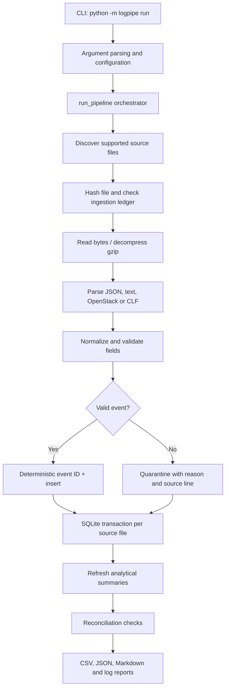

# Architecture

## Runtime flow

## Component responsibilities

| Component | Responsibility |
|---|---|
| `__main__.py` | Python module entry point |
| `cli.py` | CLI argument parsing, command dispatch, exit codes and logging setup |
| `pipeline.py` | Run orchestration, file discovery, ingestion, per-file transactions, run metrics and report publication |
| `adapters/` | Independent JSON, key/value text, OpenStack/oslo and Common Log Format parsers |
| `parser.py` | Dispatches each input line to the appropriate format adapter |
| `normalize.py` | UTC timestamp and canonical severity normalization |
| `validate.py` | Required fields, aliases, type/range checks, service reference validation and deterministic event identity |
| `db.py` | SQLite schema, constraints, indexes and connection setup |
| `report.py` | Error-rate and latency aggregations, summary table refresh and CSV writing |
| `reconcile.py` | Source-to-target, uniqueness, referential, traceability and expected-label checks |
| `generator.py` | Seeded synthetic fixtures and separate expected-answer labels for test-only scenarios |

## Reliability decisions

- A source file is processed in one SQLite transaction by default. A failed file is rolled back while other files can continue.
- A SHA-256 content ledger skips unchanged files on rerun.
- A deterministic event ID and unique database key prevent duplicate event inserts across files and formats.
- Invalid rows are retained in a quarantine table with source file, line number, raw content and reason.
- Summaries are rebuilt from the complete event store so late-arriving data can correct earlier time buckets.
- Reconciliation failure makes the run fail; it is not reported as a successful run.
- Output and database paths are excluded from recursive input discovery to prevent report files from being re-ingested.

## Important limitations

- This is a local batch pipeline, not a continuously running streaming service. A user or scheduler must invoke the CLI.
- SQLite is appropriate for a reproducible local challenge and moderate batch workloads; a production multi-writer deployment would need a server database and operational controls.
- Parser support is deliberately bounded to documented formats and patterns. Unknown formats are quarantined rather than guessed.
- Event identity is content-derived. Two truly distinct events with identical normalized identity fields may be treated as duplicates; source-specific identifiers should be added when available.
